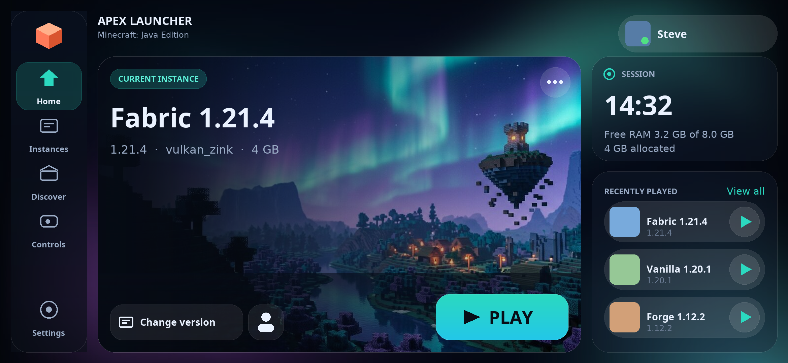

<h1 align="center">Apex Launcher</h1>



**Apex Launcher** runs *Minecraft: Java Edition* on Android, with a redesigned landscape-first
interface (**"Aurora Glass"**), and the full capabilities of the launcher it is built on:
OpenJDK 8/17/21 runtimes, Forge/Fabric/Quilt/OptiFine installers, Modrinth & CurseForge modpacks,
and a complete on-screen control editor.

Apex Launcher is a fork of [PojavLauncher](https://github.com/PojavLauncherTeam/PojavLauncher)
(v3_openjdk), which is **discontinued** upstream — its successor is
[Amethyst-Android](https://github.com/AngelAuraMC/Amethyst-Android). The fork keeps the whole
engine and rebuilds the launcher experience on top of it.

* License: **LGPLv3** (see [`LICENSE`](LICENSE)), original work by the PojavLauncher team and contributors.
* Design notes & implementation status: [`APEX_REDESIGN.md`](APEX_REDESIGN.md)
* Repository analysis & architecture map: [`REPO_ANALYSIS.md`](REPO_ANALYSIS.md)

Apex Launcher is not affiliated with Mojang or Microsoft. "Minecraft" is a trademark of
Mojang Synergies AB. A Microsoft account is required to play online.

---

## What's different from upstream

| Area | Apex Launcher |
|---|---|
| Home screen | Landscape-first "Aurora Glass" layout: navigation rail, hero instance card with live metadata, Change version / Edit instance, session card (clock + live RAM), recently played, glass progress card |
| Portrait | Portrait keeps the same content with a bottom navigation bar |
| Design system | New palette, `apex_*` drawables, custom vector icon set, adaptive launcher icon |
| Identity | App label, all shipped locales, crash reports, game folder (`games/ApexLauncher`), about text |
| Compat | Existing installs are migrated: legacy `games/PojavLauncher` folder and `pojav://` runtime references are still read |

## Building

### Quick build

The fastest path uses the pre-built JREs published by the upstream CI.

1. Clone: `git clone https://github.com/CruzCoder/ApexLauncher.git`
2. Build: `./gradlew :app_pojavlauncher:assembleDebug` (`gradlew.bat` on Windows)

The APK lands in `app_pojavlauncher/build/outputs/apk/debug/`.

### Full build

1. **Java runtime (JRE):** grab the `jre8-pojav` artifact from the
   [upstream CI](https://github.com/PojavLauncherTeam/android-openjdk-build-multiarch/actions) into
   `app_pojavlauncher/src/main/assets/components/jre`. JRE 17 and 21 go into `jre-new` and `jre-21`
   as `jre17-pojav` / `jre21-pojav`. To build them yourself, see
   [android-openjdk-build-multiarch](https://github.com/PojavLauncherTeam/android-openjdk-build-multiarch).
2. **LTW (optional):** the ANGLE-based `opengles3_ltw` renderer needs `ltw-release.aar` dropped into
   `app_pojavlauncher/libs/`; without it the renderer is hidden at runtime.
3. **Language list:** translations are auto-added upstream, so regenerate the list first:
   ```bash
   chmod +x scripts/languagelist_updater.sh && bash scripts/languagelist_updater.sh
   ```
4. **GLFW stub:** `./gradlew :jre_lwjgl3glfw:build`
5. **Launcher:** `./gradlew :app_pojavlauncher:assembleDebug`

`CURSEFORGE_API_KEY` (env var or `curseforge_key.txt`) enables CurseForge modpack search;
without it the build falls back to a dummy key and only Modrinth works.

## Current status

* [x] OpenJDK 8 / 17 / 21 mobile ports: ARM32, ARM64, x86, x86_64
* [x] OpenGL in the OpenJDK environment (GL4ES, VirGL/Zink, optional LTW)
* [x] OpenAL (works on most devices)
* [x] Mod installers: Forge (headless + GUI), Fabric, Quilt, OptiFine, Better Than Adventure
* [x] Modpack browsing and install: Modrinth, CurseForge
* [x] Multi-runtime manager with per-instance runtime selection
* [x] Rewritten controls system (drawers, joysticks, gamepads, gyro) and native input pipe
* [x] New Apex Launcher home screen (landscape + portrait)
* [ ] More to come

## Known issues

The engine is inherited from a discontinued upstream, so the usual caveats apply: renderer
compatibility varies per GPU/driver, and some devices need a specific runtime or renderer.
Build locally and check the in-app log (`Share logs` in game) when reporting a problem.

## Contributing

Bug reports and pull requests are welcome. Any change should be submitted as a PR whose
description explains what it does and how to exercise it. UI work should follow the design
tokens in `res/values/apex_dimens.xml`, `res/values/colors.xml` and `APEX_REDESIGN.md`.

## License

Apex Launcher is licensed under [GNU LGPLv3](LICENSE), inherited from PojavLauncher.
Upstream attribution is kept in the Credits section below and in the in-app about screen.

## Credits & Dependencies

* [PojavLauncher](https://github.com/PojavLauncherTeam/PojavLauncher) (upstream project this fork is based on): LGPLv3.
* [Boardwalk](https://github.com/zhuowei/Boardwalk) (JVM Launcher): Unknown License/[Apache License 2.0](https://github.com/zhuowei/Boardwalk/blob/master/LICENSE) or GNU GPLv2.
* Android Support Libraries: [Apache License 2.0](https://android.googlesource.com/platform/prebuilts/maven_repo/android/+/master/NOTICE.txt).
* [GL4ES](https://github.com/PojavLauncherTeam/gl4es): [MIT License](https://github.com/ptitSeb/gl4es/blob/master/LICENSE).
* [OpenJDK](https://github.com/PojavLauncherTeam/openjdk-multiarch-jdk8u): [GNU GPLv2 License](https://openjdk.java.net/legal/gplv2+ce.html).
* [LWJGL3](https://github.com/PojavLauncherTeam/lwjgl3): [BSD-3 License](https://github.com/LWJGL/lwjgl3/blob/master/LICENSE.md).
* [LWJGLX](https://github.com/PojavLauncherTeam/lwjglx) (LWJGL2 API compatibility layer for LWJGL3): unknown license.
* [Mesa 3D Graphics Library](https://gitlab.freedesktop.org/mesa/mesa): [MIT License](https://docs.mesa3d.org/license.html).
* [pro-grade](https://github.com/pro-grade/pro-grade) (Java sandboxing security manager): [Apache License 2.0](https://github.com/pro-grade/pro-grade/blob/master/LICENSE.txt).
* [bhook](https://github.com/bytedance/bhook) (Used for exit code trapping): [MIT license](https://github.com/bytedance/bhook/blob/main/LICENSE).
* [libepoxy](https://github.com/anholt/libepoxy): [MIT License](https://github.com/anholt/libepoxy/blob/master/COPYING).
* [virglrenderer](https://github.com/PojavLauncherTeam/virglrenderer): [MIT License](https://gitlab.freedesktop.org/virgl/virglrenderer/-/blob/master/COPYING).
* Thanks to [MCHeads](https://mc-heads.net) for providing Minecraft avatars.

## Roadmap

* Finish the Aurora Glass treatment on the remaining screens (accounts, settings, mod browser).
* Improve first-run flow (runtime installation without a bundled JRE).
* Harden release automation (deterministic `versionCode`, no branch name in `versionName`).
